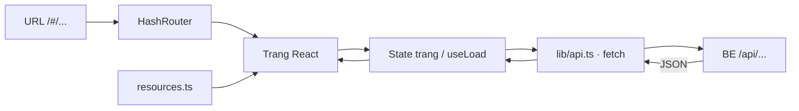

# Kiến trúc FE Block 6 — CSR, HashRouter, triển khai trong 30–45 phút

## 1. Mục tiêu và phạm vi

Chúng ta phụ trách **FE**. Mục tiêu là chuyển giao diện Bếp Nhà của Block 5 thành SPA dùng **React + Vite + TypeScript + React Router (`HashRouter`)**, gọi API JSON của người làm BE.

- Phục vụ **14 URL**: hai trang khách và bốn trang quản trị × ba tài nguyên.
- Tái sử dụng CSS, tám ảnh và bố cục EJS; chuyển phần hiển thị thành JSX.
- Dùng chung trang quản trị theo cấu hình tài nguyên để hoàn thành chức năng trong khoảng 30 phút; dành tối đa 15 phút tiếp theo cho tích hợp, kiểm tra và sửa lỗi.
- Bàn giao `web/`, lệnh chạy và `docs/spa-evidence.md` với kết quả thật.

**Hiện trạng:** FE đã được triển khai trong `web/` theo thiết kế này và đã nối với BE/DB thật. Build qua; kết quả 10 nhóm live integration, CORS, CRUD và persistence sau restart ở [FE_BE_INTEGRATION.md](C:/2026_2027/web/8-web-application-development/block-06/docs/FE_BE_INTEGRATION.md). Minh chứng fixture ban đầu vẫn được giữ riêng trong `spa-evidence.md`.

Nguồn: [bản phân công đã chốt](C:/2026_2027/web/8-web-application-development/block-06/docs/PHAN_CONG_BLOCK_06_CSR.md) và [mã Block5 đầy đủ](<C:/2026_2027/web/week3/Group8 (2)/Block5>). Đường dẫn trong phần cấu trúc bên dưới là file dự kiến tạo; đường dẫn Block5 là mã đã đọc.

**Ngân sách 30–45 phút bao gồm khởi tạo, lập trình, tích hợp và kiểm tra FE.** Điều kiện để hoàn thành đầu cuối: API đúng contract và CORS sẵn sàng trong khoảng thời gian đó. Nếu BE chưa bàn giao, tiếp tục dựng UI với fixture tạm có nhãn rõ ràng, nhưng ghi phần API/CRUD thật là chưa kiểm tra; không coi fixture là kết quả hoàn thành.

## 2. Các quyết định kiến trúc

| Hạng mục | Quyết định |
|---|---|
| Render | CSR: browser chạy React, API chỉ trả JSON |
| Routing | `HashRouter`; thanh địa chỉ dùng `/#/dishes`, `/#/admin/dishes/...` |
| HTTP | Một module `lib/api.ts`, dùng `fetch`; API base URL từ một biến môi trường |
| State | State cục bộ mỗi trang/form; không dùng Redux, Context hoặc store giữ bản ghi/danh sách |
| Admin | Ba loại trang dùng chung: danh sách, form thêm/sửa, xác nhận xóa |
| UI | Giữ CSS/class và ảnh Block 5; bổ sung thông báo tải/lỗi cần thiết |
| Dependency | React, React DOM, React Router; bộ công cụ Vite/TypeScript. Chưa thêm thư viện UI, form, cache hoặc HTTP |
| Phạm vi đầu tiên | Tìm tên món bằng `q`, chi tiết và CRUD ba tài nguyên; chưa làm login, upload, filter/sort/phân trang hoặc quản lý định lượng |



## 3. Cấu trúc file tối thiểu

```text
block-06/
  web/
    public/images/             # Chép 8 ảnh từ Block5/public/images
    src/
      main.tsx                 # Mount React, import CSS, gắn router
      app/router.tsx           # HashRouter, Routes, redirect, fallback
      types.ts                 # Resource, Dish, Chef, Ingredient, kiểu lỗi
      lib/api.ts               # API base URL, fetch, phân loại lỗi
      hooks/useLoad.ts         # GET theo path, trạng thái, retry, abort
      config/resources.ts      # Nhãn, cột bảng, trường form, whitelist
      components/
        Layout.tsx             # Header, footer, sidebar admin + Outlet
        PageState.tsx          # Loading, empty, notFound, error + retry
        DishCard.tsx           # Card món ăn dùng lại bố cục cũ
      pages/
        DishListPage.tsx       # Danh sách khách, q trên URL
        DishDetailPage.tsx     # Chi tiết theo id
        AdminListPage.tsx      # Một bảng cho cả ba tài nguyên
        AdminFormPage.tsx      # Một form cho chế độ thêm/sửa
        AdminDeletePage.tsx    # Nạp bản ghi, xác nhận, DELETE
        NotFoundPage.tsx       # URL/loại tài nguyên không hợp lệ
      styles.css               # CSS cũ + phần trạng thái SPA
      vite-env.d.ts
    index.html
    .env.example
    package.json
    pnpm-lock.yaml             # Dùng pnpm có sẵn trong môi trường thực hiện
    pnpm-workspace.yaml
    tsconfig*.json
    vite.config.ts
  docs/
    FE_ARCHITECTURE.md
    spa-evidence.md
```

Các file cấu hình theo cấu trúc Vite React/TypeScript. Bản triển khai dùng pnpm thay npm vì môi trường có pnpm; các lệnh tương ứng là `pnpm install`, `pnpm dev`, `pnpm build`. Giữ cấu trúc này trong buổi làm; chưa tách thêm các tầng service/repository hoặc tạo bộ sinh form tổng quát. Mỗi page chứa phần trình bày riêng và gọi module HTTP chung.

### Trách nhiệm từng phần

| File/phần | Chịu trách nhiệm |
|---|---|
| `router.tsx` | Chọn trang theo URL; route `/` chuyển tới `/dishes`; kiểm tra `resource` thuộc whitelist |
| `Layout.tsx` | Bố cục chung, `Link`/`NavLink`, sidebar và class `admin-body` theo pathname do router cung cấp |
| `api.ts` | Ghép URL, header JSON khi có body, kiểm tra HTTP/JSON/`ok`, chuyển thành lỗi thống nhất |
| `useLoad.ts` | Tải theo path, loading/data/error, retry; hủy request cũ khi đổi trang hoặc unmount |
| `resources.ts` | Khai báo ba tài nguyên hợp lệ, nhãn tiếng Việt, cột và trường được phép sửa; không chứa dữ liệu API |
| Page/form | State và hành vi của trang; lỗi cạnh ô; pending submit; điều hướng sau ghi |

## 4. Routing: 14 URL, sáu component trang

Trong `HashRouter`, khai báo path **không có `/#`**. Router tự tạo hash trên thanh địa chỉ.

| URL browser | Component | API cần gọi |
|---|---|---|
| `/#/dishes?q=...` | `DishListPage` | `GET /api/dishes?q=...` |
| `/#/dishes/:id` | `DishDetailPage` | `GET /api/dishes/:id` |
| `/#/admin/:resource` | `AdminListPage` | `GET /api/:resource` |
| `/#/admin/:resource/new` | `AdminFormPage`, chế độ thêm | `POST /api/:resource` khi submit |
| `/#/admin/:resource/:id/edit` | `AdminFormPage`, chế độ sửa | GET bản ghi; PATCH khi submit |
| `/#/admin/:resource/:id/delete` | `AdminDeletePage` | GET bản ghi; DELETE chỉ sau xác nhận |
| URL khác | `NotFoundPage` | Không gọi API cho resource lạ |

`:resource` chỉ nhận `dishes`, `chefs`, `ingredients`. Hai route công khai + bốn route admin × ba resource = **14 URL**; fallback không tính vào con số này. `/` và `/admin` có thể redirect bằng `<Navigate replace>` tới trang danh sách phù hợp.

- Link nội bộ: `<Link to="/dishes/1">`; ghi xong: `navigate('/admin/dishes')`.
- Tìm kiếm: `useSearchParams` đọc/ghi `q`; submit tìm kiếm cập nhật `/#/dishes?q=...`, trang tải lại API theo `q`.
- Không dùng `window.location.search` để đọc query bên trong hash.
- URL API không chứa `#`. Ví dụ trang `/#/dishes/1` gọi `http://localhost:3000/api/dishes/1`.
- Mở trực tiếp/reload URL hash gửi `/` tới server FE, rồi router xử lý phần hash. Vẫn kiểm tra tab mới, reload, Back/Forward và URL hash không khớp.

## 5. Contract tích hợp BE

### Cấu hình chạy

```dotenv
VITE_API_BASE_URL=http://localhost:3000/api
```

Đây là URL công khai được nhúng vào FE. BE cần cho phép origin `http://localhost:5173`. Chạy dev server với port 5173 cố định (`strictPort`) để không tự đổi port làm sai CORS; nếu cổng bận, xử lý cổng hoặc cập nhật origin với BE. Không dùng dev proxy cho bài kiểm tra CORS.

### Dữ liệu tối thiểu

| Kiểu | Trường FE dùng |
|---|---|
| `Dish` | `id: number`, `name`, `description`, `price: number`, `category`, `available: boolean`, `chefId: number`; `imageUrl?`, `imagePath?`, `chef?`, `ingredients?` |
| `Chef` | `id: number`, `name`, `specialty`, `bio?` |
| `Ingredient` | `id: number`, `name`, `unit` |

Các trường quan hệ mở rộng là tùy chọn để UI không lỗi khi BE chỉ trả trường cơ bản. Trang chi tiết luôn hiển thị đủ trường bắt buộc của món ăn. Chỉ hiển thị khối chef/nguyên liệu nếu response có dữ liệu; chưa gọi thêm endpoint quan hệ ngoài contract.

FE ưu tiên tám ảnh seed Block5 đã có trong `public/images` khi `imagePath` khớp `seed/<tên-ảnh>` hoặc `/images/<tên-ảnh>` đã biết. Ảnh khác dùng `imageUrl` do BE trả; thiếu URL thì dùng `/images/beef.png`. Quyết định này tránh ảnh seed bị trắng trong lúc chờ Storage; không tự ghép URL từ thông tin bí mật. Giá định dạng bằng `Intl.NumberFormat('vi-VN', { style: 'currency', currency: 'VND', maximumFractionDigits: 0 })`.

### API client dùng chung

Interface dự kiến:

```ts
request<T>(path: string, options?: RequestInit): Promise<T>
// Thành công trả data, bao gồm null khi DELETE.
// Lỗi: { kind, message, status?, code?, fields? }.
```

| Kết quả request | Cách xử lý |
|---|---|
| Mạng/CORS, không nhận response | `kind: 'network'`; thông báo chung, trang đọc có nút thử lại |
| HTTP không thành công, ví dụ 404/500 | `kind: 'http'`; thông báo lỗi kỹ thuật, không biến 404 URL thành NOT_FOUND bản ghi |
| HTTP thành công nhưng không phải JSON hoặc sai envelope | `kind: 'response'`; báo phản hồi API không hợp lệ |
| `200, {ok:false,error:{code:'NOT_FOUND'}}` | `kind: 'business'`; trang hiện không tìm thấy bản ghi |
| `200, {ok:false,error:{code:'VALIDATION_FAILED',fields}}` | Hiện lỗi cạnh trường và lỗi chung nếu có; giữ nguyên form |
| `200, {ok:true,data}` | Trả `data` cho page |

API client kiểm tra HTTP trước khi đọc envelope nghiệp vụ; chỉ đặt `Content-Type: application/json` khi có JSON body. Chuẩn hóa `fields` về thông báo chuỗi để form dùng thống nhất; nếu BE trả mảng thông báo thì nối chúng tại đây. Request bị hủy do chuyển trang không hiển thị thành lỗi mạng. Không tự retry POST/PATCH/DELETE khi chưa biết thao tác trước đã ghi hay chưa.

Năm thao tác của mỗi resource: GET danh sách, GET theo ID, POST, PATCH, DELETE. Danh sách trả `{ok:true,data:[]}`, không phải object phân trang. Status 200 cho thành công và lỗi nghiệp vụ là quy ước của đề; lỗi kỹ thuật vẫn 400/404/500.

## 6. Admin dùng chung và luồng dữ liệu

### Cấu hình ba tài nguyên

| Resource | Cột chính | Trường form |
|---|---|---|
| `dishes` | Tên, danh mục, giá, trạng thái, thao tác | `name`, `description`, `price`, `category`, `available`, `chefId` |
| `chefs` | Tên, chuyên môn, thao tác | `name`, `specialty` |
| `ingredients` | Tên, đơn vị, thao tác | `name`, `unit` |

`resources.ts` có thể chứa mảng trường với loại đơn giản `text`, `textarea`, `number`, `select`, `checkbox`. `AdminFormPage` dùng một switch nhỏ để render input; không xây DSL hoặc thư viện form riêng. Danh mục lấy bốn giá trị hiện có của Block 5: Khai vị, Món chính, Món chay, Tráng miệng.

Riêng form dishes gọi thêm `GET /api/chefs` để tạo lựa chọn đầu bếp vì schema Block 5 bắt buộc `chefId`. Nếu danh sách chef rỗng hoặc tải lỗi, báo rõ và khóa lưu; cho link tới `/#/admin/chefs/new` khi cần thêm đầu bếp. Nếu `chefId` hiện tại chưa có trong lựa chọn, giữ giá trị và báo cần chọn lại, không tự chọn đầu bếp khác.

### Tải trang

1. Lấy `resource`, `id`, `q` từ router; kiểm tra resource trước khi ghép URL.
2. `useLoad` tải dữ liệu, state nằm ở page: `loading → success/empty/notFound/error` theo loại trang.
3. Mỗi lần đổi resource/id/query hoặc retry, hủy request cũ và tải theo URL mới; không để response cũ ghi đè trang mới.
4. Với form thêm, không gọi GET bản ghi. `useLoad` cho phép path `null` để bỏ qua tải này, vẫn tuân thủ quy tắc gọi hook.
5. Đổi resource/id/chế độ thì reset form, lỗi và pending; chỉ khởi tạo giá trị sửa sau khi đã nạp đúng bản ghi hiện tại.

### Submit thêm/sửa

1. `preventDefault`; chặn gửi lại khi `pending=true`.
2. Kiểm tra đầu vào cơ bản: name trim không rỗng; price không trống, là số nguyên >= 0; chefId là ID hợp lệ. Dùng kiểm tra FE để hỗ trợ nhập liệu; BE vẫn validate độc lập.
3. Tạo JSON từ whitelist trường form. Chuyển price/chefId thành number, available thành boolean; không chuyển chuỗi rỗng/null thành giá 0.
4. POST gửi dữ liệu tạo; PATCH gửi các trường editable thực sự thay đổi so với bản đã tải. Không có thay đổi thì không gửi request. Không gửi nguyên object response, ảnh, ID, bio hoặc quan hệ nguyên liệu ngoài form.
5. Khóa nút lưu trong lúc gửi; với `VALIDATION_FAILED`, giữ draft và hiển thị `fields` cạnh input. Dùng vùng lỗi chung cho thông báo không gắn trường hoặc trường chưa có trên form.
6. Khi `ok:true`, `navigate('/admin/' + resource)`; trang danh sách tự GET dữ liệu mới. Không cập nhật bản sao danh sách toàn cục.

Theo kế hoạch tái sử dụng schema, BE cấp ảnh mặc định khi tạo món không upload; PATCH không gửi ảnh/quan hệ thì BE giữ nguyên. Cần chốt hai hành vi này với BE ở phút 0–5.

### Xóa

Trang xác nhận tự GET bản ghi từ ID trên URL. Mở trang không làm thay đổi dữ liệu. Chỉ nút **Xác nhận xóa** gửi DELETE; khóa nút khi đang gửi. Thành công quay về danh sách; lỗi ràng buộc chef/ingredient đang được dùng hiển thị thông báo trên trang, không tự xóa món liên quan. Nút hủy là `Link` quay lại danh sách và không gửi DELETE.

## 7. Tái sử dụng giao diện Block 5

| Nguồn Block 5 | Đích FE / cách chuyển |
|---|---|
| `public/styles.css` | `src/styles.css`: giữ tên class và bố cục; thêm loading/error/disabled |
| `public/images/*.png` | `web/public/images/`: chép tám ảnh, không tạo ảnh mới |
| `views/partials/header.ejs`, `footer.ejs`, `admin-nav.ejs` | `Layout.tsx`: đổi link nội bộ thành Link/NavLink; không đưa script SSR vào SPA |
| `views/menu.ejs`, `partials/card.ejs` | `DishListPage.tsx`, `DishCard.tsx`: JSX thay EJS; dữ liệu từ GET API |
| `views/detail.ejs` | `DishDetailPage.tsx`: giữ bố cục; kiểm tra dữ liệu quan hệ tùy chọn trước khi render |
| `views/admin-list.ejs` | `AdminListPage.tsx`: bảng theo resource, bỏ điều khiển chưa có API tương ứng |
| `views/form.ejs`, `delete.ejs` | `AdminFormPage.tsx`, `AdminDeletePage.tsx`: draft/pending/errors cục bộ, JSON và router navigation |

Điểm dễ lỗi khi chuyển:

- `class` → `className`, `for` của label → `htmlFor`; vòng lặp → `map` có `key`.
- Các link neo cũ `href="#menu"`, `href="#our-story"` xung đột với hash routing. Dùng nút gọi `scrollIntoView` khi đang ở trang tương ứng hoặc bỏ link neo chưa cần; không thay fragment của router.
- Không chép `public/admin-forms.js`: nó nhận HTML và thay document. React xử lý form qua API JSON.
- Không dùng `window.location.assign`, `innerHTML`, `dangerouslySetInnerHTML` hoặc `<a href="/dishes">` cho điều hướng nội bộ.
- Dữ liệu hiển thị qua JSX; input lấy giá trị `0` bằng `??`/kiểm tra tường minh, không dùng `price || ''` làm mất giá 0.
- Không đưa dòng giới thiệu “HTML được render trên server”, form `_method`, CSRF token hoặc yêu cầu upload bắt buộc của giao diện cũ vào bản FE mới.

## 8. Lịch thực hiện 30–45 phút

Mốc là phút tính từ khi bắt đầu làm FE. Chúng ta triển khai tuần tự và tích hợp sớm, không cần tách thêm người lập trình FE.

| Mốc | Công việc | Kết quả phải thấy |
|---|---|---|
| **00–05** | Scaffold Vite React/TS; cài router; chép CSS/ảnh; chốt API base URL, CORS, payload dishes với BE; tạo types/API client | Dev server chạy ở 5173; có layout và đọc được một response API hoặc ghi rõ lỗi kết nối |
| **05–10** | HashRouter, Layout, PageState, useLoad; danh sách/chi tiết dishes và q trên URL | `/#/dishes` → `/#/dishes/1`; GET thật, loading/error cơ bản |
| **10–20** | Cấu hình resource; AdminList/Form/Delete; hoàn thiện CRUD dishes và lựa chọn chef | Sáu URL dishes chạy, form lỗi giữ giá trị, xóa có xác nhận |
| **20–25** | Áp cấu hình chefs/ingredients vào ba trang admin dùng chung; hoàn thiện whitelist/fallback | Đủ 14 URL; CRUD hai tài nguyên còn lại gọi API tương ứng |
| **25–30** | Chạy một vòng CRUD cho mỗi resource; rà điều hướng, reset state, errors, pending; sửa lỗi chặn luồng | Bản đủ chức năng nếu BE đúng contract; build lần đầu |
| **30–40** | Kiểm tra URL sâu, Back/Forward, q, NOT_FOUND, validation, API tắt/sai URL, Network/CORS; sửa lỗi phát hiện | Kết quả đã kiểm chứng, có output/ảnh minh chứng |
| **40–45** | Chạy lại build và luồng bị ảnh hưởng nếu đã sửa; chốt lệnh chạy/evidence và phần còn thiếu | Bản bàn giao chạy được và mô tả đúng trạng thái |

**Mốc xử lý vướng mắc:** phút 5 chưa gọi được API thì ghi rõ lỗi và báo người làm BE; vẫn dựng các page/state với fixture tạm, không thêm tầng mock CRUD riêng. Phút 20 ưu tiên hoàn thiện mẫu admin để lặp lại; phút 30 dừng thêm tính năng. Các phút còn lại dành cho sửa lỗi, nghiệm thu và bằng chứng. Nếu API chưa sẵn sàng thì báo đúng phần chưa kiểm tra, không kéo thời gian bằng các tính năng ngoài đề.

## 9. Checklist bàn giao FE

- [x] `pnpm dev` chạy tại `web/`, cố định host/port/strictPort trong script; mở bằng `http://localhost:5173` để khớp origin đã chốt.
- [x] `pnpm build` thành công; cấu hình build kiểm tra TypeScript và tạo bundle Vite.
- [ ] Đủ hai URL khách và bốn URL quản trị cho từng resource, tất cả dùng `/#/...`.
- [ ] Tìm kiếm giữ q qua reload/Back; request là `/api/dishes?q=...`.
- [ ] CRUD ba tài nguyên dùng API thật; dữ liệu sau ghi được GET lại và còn sau reload.
- [ ] Giá 0, available=false, lỗi từng ô, pending và hủy/xác nhận xóa đúng.
- [ ] PATCH từ FE không gửi/ghi đè ảnh hoặc quan hệ ngoài form; dữ liệu cũ được bảo toàn theo contract BE.
- [ ] NOT_FOUND khác lỗi HTTP/mạng; loading/empty/error có UI; request bị hủy không tạo lỗi giả.
- [ ] Reload URL sâu, chuyển nhanh giữa các ID/resource, Back/Forward không giữ dữ liệu form của bản ghi trước.
- [ ] Link nội bộ và ghi không tạo document request mới; URL lạ/resource lạ hiện fallback.
- [ ] CSS cũ hiển thị được cả menu/admin ở desktop và màn hình hẹp; không có link neo phá hash router.
- [ ] `docs/spa-evidence.md` ghi lệnh chạy, API base URL, URL đã thử, kết quả, ảnh/output và lỗi còn lại. Không tự đánh dấu đạt cho phần dùng fixture.

Không xây thêm bộ test lớn trong ngân sách này. Ưu tiên build và kiểm tra trực tiếp các luồng trên; nếu phát hiện lỗi khó tái hiện, thêm kiểm tra nhỏ đúng lỗi cần sửa. Bàn giao hoàn thành khi các mục bắt buộc có kết quả thực tế, không chỉ có component hoặc route trong mã.
