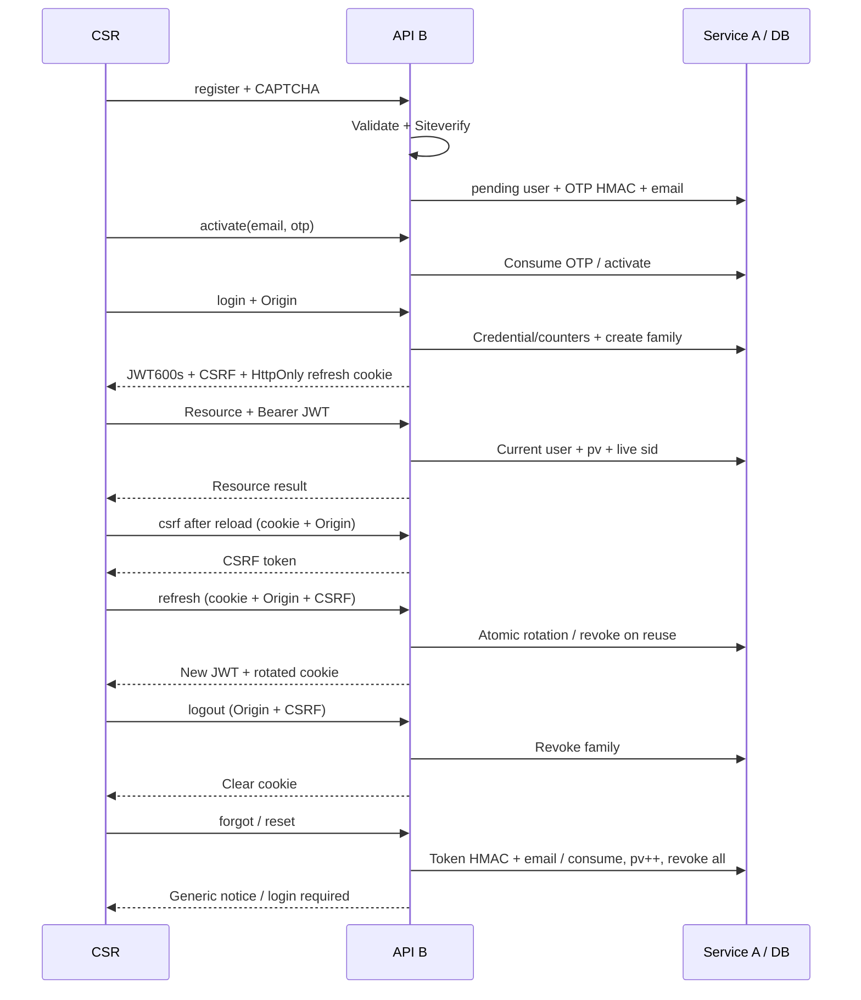

# Bàn giao B — API, JWT và tích hợp

> Cập nhật sau merge A/B ngày 13/11/2026: schema/service A đã có trong `../ROLE_A_HANDOFF.md`, nhưng adapter production chưa nối. Nội dung dưới đây giữ lại thiết kế/bằng chứng B ban đầu. Package hợp nhất dùng bcryptjs 3.0.3, Nodemailer 10.3.1, @types/nodemailer 8.0.2 từ A và jose 6.2.17 từ B; không hạ dependency về phiên bản ghi trong bản bàn giao cũ.

## Phạm vi và quyết định

Áp dụng contract gốc tại `block-09/BAI1_CONTRACT.md`. Người giao việc đã xác nhận làm B qua interface adapter vì chưa có DTO/service từ A, và yêu cầu copy/ghép nền Block 7/8 trước khi hoàn thiện B.

Không thay schema/migration để giả lập phần A. Các helper thuộc phạm vi A được chuẩn bị trong bước ghép nền theo yêu cầu trên; sau bước này A tiếp tục sở hữu `services/auth/**` và `validation/auth.ts`.

Nhánh làm việc: `codex/block09-b-auth-api`. Không commit/stage các thay đổi có sẵn ở Block 7/8.

Dependencies mới được khóa trong package/lockfile: `jose 6.2.17`, `bcryptjs 3.0.2`, `nodemailer 7.0.13`, `@types/nodemailer 7.0.12`. Các framework và Prisma giữ từ Block 7.

## File B

- `api/src/routes/auth.ts`: toàn bộ 10 endpoint auth mục 4.
- `api/src/middleware/require-auth.ts`: Bearer signature/claims, user active/verified, passwordVersion và family còn hoạt động.
- `api/src/lib/auth-jwt.ts`: JWT HS256, TTL 600 giây, issuer/audience, sub/jti/sid/iat/exp/pv.
- `api/src/lib/auth-errors.ts`: mã lỗi, thông báo cố định, status và Retry-After.
- `api/src/lib/auth-http.ts`: exact origin allowlist, CSRF HMAC/constant-time, đọc/ghi/xóa refresh cookie.
- `api/src/lib/auth-services.ts`: interface/DTO/error contract với A; adapter mặc định không cấp auth khi chưa tích hợp.
- `api/src/app.ts`: factory nhận adapter; CORS trước parser/error handler; mount auth/resources; ánh xạ lỗi auth, giữ quy ước lỗi tài nguyên/technical của Block 7.
- `api/src/routes/resources.ts`: gắn middleware; giữ handler/search/pagination.
- `api/package.json`, lockfile, `.env.example`: dependency, script và config.
- `api/tests/auth.test.ts`, `tests/helpers/auth-fixture.ts`, cập nhật `tests/api.test.ts`: test boundary của B và regression tài nguyên.
- `api/scripts/agent-bug-demo.mts`, `scripts/verify-snapshot.mjs` và bằng chứng trong `docs/`.

## Interface A cần implement

Nguồn chuẩn là `api/src/lib/auth-services.ts`, dùng `AuthError` từ `lib/auth-errors.ts` để B giữ chính xác HTTP status/code. Không đưa `passwordHash`, OTP, token hash hoặc record Prisma vào response DTO.

| Method | Nghĩa vụ phía service A |
| --- | --- |
| `enforceIpLimit(action, ip)` | Bộ đếm DB atomic, khóa IP HMAC; quota từ `AUTH_IP_LIMITS`, cửa sổ 15 phút; throw `RATE_LIMITED` và có thể cung cấp retryAfter giây. |
| `register(input, context)` | B đã validate và verify CAPTCHA trước khi gọi. Tạo pending/viewer phía server; bcrypt12; OTP HMAC; email mới/trùng trả cùng kết quả; xử lý lỗi SMTP không làm lộ trạng thái email. Không verify lại cùng CAPTCHA đã dùng. |
| `activate(input, context)` | Consume OTP atomic, hạn 10 phút, tối đa 5 lần sai; mọi OTP sai/hết hạn/đã dùng/hết lượt throw `INVALID_OTP`; không tạo phiên. |
| `resend(input, context)` | Generic result; cooldown60s, 5 email/giờ; không reset số lần thử hoặc mở lại OTP hết lượt. |
| `login(input, context)` | Bộ đếm account/IP và bcrypt như Block 8. Khi cần CAPTCHA, gọi `context.verifyCaptcha(input.captchaToken)` trước bcrypt. Sai/pending dùng mã lỗi hợp đồng; khóa dùng429. Đọc lại user và atomically tạo family sau khi kiểm tra password. Trả SessionGrant. |
| `forgot(input, context)` | B verify CAPTCHA trước khi gọi. Token random32 bytes/hex64, HMAC, TTL30phút; cooldown/quota email; unknown/pending/cooldown/SMTP lỗi cùng success. |
| `reset(input, context)` | Consume token đúng một lần; hash password12; tăng passwordVersion và revoke tất cả family cùng transaction; không login. |
| `inspectRefresh(rawToken)` | HMAC lookup bằng AUTH_TOKEN_SECRET, trả AuthSession và user hiện tại; bao gồm token đã dùng để phát hiện reuse; không consume/rotate. |
| `rotateRefresh(rawToken)` | Đọc lại user/version/expiry trong transaction; consume cũ, tạo mới cùng family, ghi replacedById. Idle7 ngày, absolute30 ngày từ login. Race/reuse phải commit revoke cả family **trước khi** throw REFRESH_TOKEN_REUSED, tránh rollback phần revoke. |
| `revokeFamily(familyId)` | Revoke mọi record trong family; idempotent. |
| `findAccessSession(userId, familyId)` | Đọc user DB hiện tại và một record cùng family chưa dùng/chưa revoke/còn cả idle và absolute TTL. Trả null nếu không còn phiên; userId nhận từ JWT dưới dạng string, A đổi sang kiểu ID DB phù hợp. |

`AuthSession.passwordVersion` là phiên bản mật khẩu tại thời điểm tạo phiên, **không phải** đơn thuần copy từ user hiện tại; A phải cung cấp snapshot này để B so với `user.passwordVersion`. Cách lưu cần được A/nhóm thống nhất cùng schema; B không tự thêm cột.

`SessionGrant.refreshToken` là credential raw vừa tạo, chỉ tồn tại tạm để B đặt cookie. Service chỉ lưu HMAC-SHA-256 trong DB, không ghi raw vào log. Mọi Date trong DTO phải là `Date`, không phải chuỗi JSON. `AuthUser` chỉ chứa các trường được khai báo trong interface.

Để nối production, A xuất object implement `AuthServices` từ module của mình; B thay wiring cuối `api/src/app.ts` thành:

```ts
import { authServices } from './services/auth/index.js';
// Giữ nguyên createApp và routes.
export const app = createApp(authServices);
```

File `services/auth/index.ts` chưa được tạo giả. Test fixture chỉ nằm trong `tests/`; không import fixture trong production.

## HTTP và frontend C

- Login/refresh trả `{ ok: true, data: { accessToken, tokenType: 'Bearer', expiresIn: 600, csrfToken, user } }`.
- `GET /me` trả `{ ok: true, data: { id, name, email, role } }`; role chỉ là dữ liệu, không quyết định quyền CRUD.
- `/csrf` trả duy nhất `data.csrfToken`, không rotate hoặc cấp JWT. Sau reload: `/csrf` → `/refresh` → `/me`.
- Login, csrf, refresh, logout dùng credentials include và Origin exact allowlist. Refresh/logout có cookie live cần X-CSRF-Token hợp lệ; Origin được kiểm tra kể cả logout không có cookie.
- Refresh cookie tên `refresh_token`: HttpOnly, Secure, SameSite=Strict, Path=/api/auth, không Domain; Max-Age bị chặn bởi idle và absolute expiry. Xóa cookie dùng cùng thuộc tính/path.
- `UNAUTHENTICATED`401 cho access thiếu/sai/hết hạn hoặc user/family/version không hợp lệ. `INVALID_REFRESH_TOKEN`401; reuse401 `REFRESH_TOKEN_REUSED` và xóa cookie; CSRF403; origin403; quota429; các lỗi nghiệp vụ bắt buộc giữ200.
- C cần giữ token trong memory, single-flight refresh và retry tối đa một lần; không refresh sau403. Phần này chưa sửa trong snapshot web.

## Env và migration

Copy `api/.env.example` thành `.env` ở máy chạy và điền giá trị riêng. Không có secret thật trong working copy. Giữ `DIRECT_URL`/Storage env của Block 7 cho schema/seed/ảnh cũ.

`JWT_SECRET` và `AUTH_TOKEN_SECRET` riêng biệt, tối thiểu32 bytes; không fallback SESSION_SECRET. Issuer mặc định `bep-nha-api`, audience `bep-nha-web`. Cấu hình `SPA_ORIGINS` là danh sách exact origin; mặc định localhost và127.0.0.1 port5173, không tự thêm origin khi đã cấu hình allowlist. `WEB_ORIGIN` dùng tạo email `/reset?token=...`.

Turnstile cần secret và `TURNSTILE_ALLOWED_HOSTNAMES`; không có bypass dev trong runtime. SMTP giữ các env Block 8. Cookie Secure luôn bật theo contract; web/API cần cùng hostname và môi trường trình duyệt chấp nhận Secure cookie.

Chưa có migration auth mới. Sau khi A bàn giao: review migration bổ sung, generate Prisma client, deploy migration lên DB thử nghiệm riêng, nối adapter và chạy kiểm thử tích hợp. Không xóa ba migration gốc của Block 7; không đổi schema nghiệp vụ theo schema SSR Block 8.

## Luồng auth



## Kiểm thử và giới hạn bằng chứng

`npm run build` đạt. `npm test` đạt41/41: regression tìm kiếm/phân trang/CRUD, chính sách validate, CAPTCHA trước service, cookie, JWT claims, Origin/CSRF, refresh rotation/replay/race, logout, inactive/pv mismatch, error statuses và default503. CRUD của Block 7 được kiểm tra với user viewer để xác nhận không dùng role làm RBAC.

Các test dùng adapter giả lập trong `tests/helpers/auth-fixture.ts` và Prisma mock kế thừa từ Block 7; không chứng minh transaction PostgreSQL, gửi mail thật, Turnstile thật hay các ngưỡng/cooldown nghiệp vụ A. Các phần đó cần test service của A và chạy end-to-end sau tích hợp, gồm OTP hết lượt/resend, login brute force, reset revoke nhiều thiết bị, Network/Storage và single-flight phía C.

Minh họa lỗi agent: `npm run demo:agent-bug` tạo module tạm dưới thư mục `.agent-bug-*`, bỏ riêng so sánh `JWT.pv` với user hiện tại. Module lỗi chấp nhận JWT cũ; middleware thật trả401. Script kiểm tra cả hai kết quả, chỉ lưu boolean, rồi xóa module lỗi. Bằng chứng tại `agent-bug-demo.json`, không có token/secret/OTP và không đưa code lỗi vào app.

Tham khảo triển khai: [jose](https://github.com/panva/jose), [jwtVerify](https://github.com/panva/jose/blob/main/docs/jwt/verify/functions/jwtVerify.md), [Cloudflare Siteverify](https://developers.cloudflare.com/turnstile/get-started/server-side-validation/), [MDN Set-Cookie](https://developer.mozilla.org/en-US/docs/Web/HTTP/Reference/Headers/Set-Cookie).
