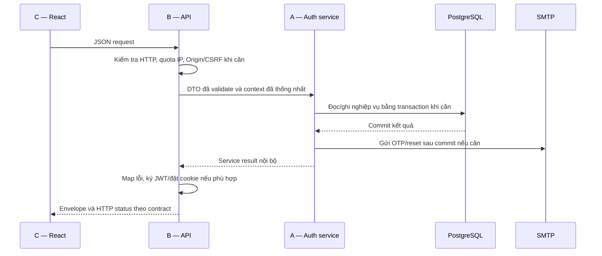

# Kế hoạch Role A — Bài 1, Block 09

## 1. Căn cứ và trạng thái

- Ngày lập: **13/11/2026**, múi giờ Asia/Saigon.
- Người dùng xác nhận “bản abstract” là [BAI1_CONTRACT.md](./BAI1_CONTRACT.md).
- Yêu cầu: lập kế hoạch **40 phút** cho **A — Dữ liệu và nghiệp vụ auth**, giải thích chi tiết việc làm, lý do và luồng xử lý.
- Trạng thái: **đã triển khai tầng dữ liệu/service Role A và kiểm thử**; xem `history.md` cho diễn biến thực tế, `BAI1/ROLE_A_HANDOFF.md` cho giao tiếp bàn giao và giới hạn. Các mốc dưới đây giữ lại kế hoạch ban đầu, không phải thời lượng thực tế từng bước.
- Kế hoạch nằm trong `block-09/plan.md`; quá trình làm việc, quyết định và thay đổi thực tế được ghi theo thứ tự trong `block-09/history.md`.

### Kết quả khảo sát làm cơ sở

1. Tại thời điểm khảo sát ban đầu, `block-09` có `README.md` và `BAI1_CONTRACT.md`; chưa có working copy `BAI1/api` và `BAI1/web`.
2. `block-07/api` có Express 5, TypeScript, Prisma 6.12.0, PostgreSQL, schema nghiệp vụ và migration tìm kiếm. Phải giữ cả `Dish.searchVector`, index/trigger và toàn bộ migration history.
3. `block-08/src/app.ts` mount `src/auth/routes.ts`; nghiệp vụ auth tham chiếu nằm trong `src/auth/**`. Các module đăng ký cũ trong `src/services/**` không phải nguồn chuẩn để chuyển sang CSR.
4. `block-08/src/auth/routes.ts` chứa cấp OTP, xác minh, đăng ký và resend, đang gắn với Express/EJS/session. Cần tách nghiệp vụ, không chép nguyên router.
5. `block-08/src/auth/password-recovery.ts` có luồng forgot/reset và tiêu thụ token bằng transaction. Phải thay thu hồi `Session` bằng thu hồi refresh family.
6. `block-08/src/auth/tokens.ts` có clock, HMAC và transaction Serializable với retry lỗi `P2034`; có thể kế thừa cách xử lý nhưng phải bỏ fallback `SESSION_SECRET` và giữ đúng công thức hash refresh trong contract.
7. README Block 8 ghi nhận từng dùng chung PostgreSQL với Block 7. Đây là cảnh báo cần kiểm tra migration history thực tế trước khi áp dụng DDL, không phải bằng chứng DB hiện tại đã sẵn sàng.

## 2. Đích bàn giao và giới hạn 40 phút

**Đích:** một bản triển khai ứng viên cho tầng dữ liệu/service của Role A để B tích hợp, kèm schema/migration bổ sung, DTO dự kiến, kết quả kiểm tra thực tế và danh sách còn thiếu.

40 phút là timebox triển khai đầu tiên. Với hiện trạng chưa có working copy, không thể bảo đảm toàn bộ auth đã chạy và được kiểm chứng trên PostgreSQL trong thời gian này. Các bước cài dependency, chuẩn bị DB, xử lý migration lệch và đợi thống nhất A–B có thể làm giảm phần code hoàn tất. Không bỏ transaction, quota hoặc kiểm tra reuse để vừa thời gian; nếu hết giờ thì ghi rõ phần chưa xong.

**Điều kiện thuận lợi để hoàn thành bản ứng viên trong 40 phút:** working copy được tạo nhanh từ Block 7; B sẵn sàng chốt giao tiếp/cài dependency; có DB thử nghiệm riêng đúng baseline; có email/CAPTCHA giả lập để kiểm thử. Không cần SMTP thật để kiểm thử service.

### Phạm vi sở hữu

| A thực hiện | B thực hiện | C thực hiện |
|---|---|---|
| Schema/migration auth; validation; bcryptjs; đăng ký/OTP/resend; forgot/reset; email/quota; nghiệp vụ refresh family, rotation/reuse/revoke | HTTP route và mapping lỗi; JWT; middleware `sid`/`pv`; Origin/CSRF; cookie/CORS; rate limit theo endpoint; dependency/lockfile và env API | Form; access/CSRF trong memory; single-flight refresh; khôi phục sau reload; điều hướng |

Ranh giới cần thống nhất: A cung cấp dữ liệu `LoginAttempt` và helper bộ đếm nếu B sử dụng; B điều phối endpoint login. Không mang quyền admin, mã mời, RBAC, MFA hoặc Express session vào Bài 1.

### File dự kiến trước khi sửa code

Các tên service dưới đây là **đề xuất bố trí**, cần thống nhất với B, không phải tên đã có trong source.

| File dưới `BAI1/api/` | Nội dung | Căn cứ contract |
|---|---|---|
| `prisma/schema.prisma` | Bổ sung User, OTP, LoginAttempt, reset, refresh; giữ nguyên model nghiệp vụ | Mục 3, mục 5 Role A |
| `prisma/migrations/<timestamp>_csr_auth/migration.sql` | DDL bổ sung sau baseline Block 7 | Mục 1, 3, 5 |
| `src/validation/auth.ts` | Email/name/password/OTP/reset DTO; bỏ invitationCode, strip role client | Mục 2–4 |
| `src/services/auth/tokens.ts` | Random, HMAC, TTL, clock, transaction/retry | Mục 2–3 |
| `src/services/auth/registration.ts` | Tạo pending user, cấp OTP, resend, activate | Mục 3–4 |
| `src/services/auth/password-recovery.ts` | Forgot và reset nguyên tử, tăng passwordVersion | Mục 3–4 |
| `src/services/auth/refresh.ts` | Tạo/kiểm tra family, rotate, reuse, revoke | Mục 2–4 |
| `src/services/auth/email.ts` | Nodemailer và nội dung email; link dựa WEB_ORIGIN | Mục 2 |
| `src/services/auth/login-attempts.ts` | Helper account/IP nếu A–B chốt A cung cấp | Mục 2, 3, 5 |
| `tests/auth-services.test.ts` và test DB đồng thời nếu có | Bằng chứng cho nghiệp vụ và transaction | Mục 7; cần thống nhất quyền sửa tests |

`src/validation.ts` của Block 7 và thư mục mới `src/validation/` có thể cùng tồn tại; giữ import validation resource hiện tại. A không tự sửa `app.ts`, route, JWT helper, file lỗi chung hoặc `.env.example` của B. Ngoại lệ đã được người dùng xác nhận khi bắt đầu: A cập nhật package/lockfile và test script cần cho build–test. Bàn giao nhu cầu thay đổi qua danh sách rõ ràng.

## 3. Lịch thực hiện đúng 40 phút

Mốc tính tương đối từ lúc bắt đầu triển khai; thực hiện tuần tự bởi người đảm nhận Role A.

| Mốc | Thời lượng | Việc cụ thể | Vì sao làm lúc này | Đầu ra/điểm kiểm tra |
|---|---:|---|---|---|
| 00–04 | 4 phút | Kiểm tra working copy; phối hợp tạo snapshot Block 7 vào BAI1 nếu chưa có, giữ migration và tìm kiếm; loại `.env`, node_modules, build/cache khi chép. Xác định DB thử nghiệm và baseline migration. | Mọi service phải xây trên đúng schema; tránh sửa nguồn cũ hoặc áp dụng migration vào DB lệch. | Có cây API/web chung hoặc ghi rõ chưa sẵn sàng; xác định baseline. Không chạy reset/seed để “sửa nhanh”. |
| 04–08 | 4 phút | Chốt với B DTO/service result, trách nhiệm CAPTCHA/login-attempts, lưu passwordVersion của refresh và phạm vi tests. Gửi danh sách dependency/env cho B. | B có thể làm route theo giao tiếp ổn định; tránh A và B tự thiết kế hai luồng khác nhau. | Bảng giao tiếp ở mục 6 được xác nhận hoặc đánh dấu pending; tiếp tục phần độc lập nếu chưa có phản hồi. |
| 08–14 | 6 phút | Thêm model auth, khóa unique/index và relation; chuẩn bị migration bổ sung. Rà diff, giữ nguyên schema nghiệp vụ và migration cũ. Generate client khi dependency đã sẵn sàng. | Schema là nền cho kiểu dữ liệu và transaction; làm trước để giảm sửa lại service. | Schema/migration ứng viên, không có DROP/ALTER phá nghiệp vụ; ghi rõ migration mới chỉ tạo hay đã áp dụng ở DB thử nghiệm. |
| 14–18 | 4 phút | Tách validation, bcrypt cost 12, helper random/HMAC/clock/TTL/transaction. Chuẩn bị mail adapter từ source đang chạy. | Các luồng dùng chung chính sách và cách xử lý thời gian; clock/email thay thế được giúp kiểm tra nhanh. | Không còn SESSION_SECRET fallback, invitationCode, EJS/session import trong service mới. |
| 18–25 | 7 phút | Tách register → issue OTP → activate/resend. Giữ email unique, role viewer/pending, CAPTCHA trước bcrypt, cooldown/quota/attempts, response chung. Gửi mail sau commit. | Đây là đường tạo tài khoản hợp lệ để login/refresh sử dụng; có thể tái sử dụng nhiều nghiệp vụ Block 8. | OTP một lần; sai lần 5 bị tiêu thụ; resend không reset attempts; email trùng không bị sửa mật khẩu/role. |
| 25–30 | 5 phút | Tách forgot/reset: token hex, quota, SMTP failure handling, CAS consume; đổi hash + tăng passwordVersion + revoke mọi family trong cùng transaction. | Tái sử dụng phần lớn source Block 8 nhưng cần sửa cơ chế vô hiệu hóa phiên CSR. | Không tiêu thụ token khi GET; reset thành công không cấp JWT; token và family cũ bị vô hiệu. |
| 30–36 | 6 phút | Làm refresh service: tạo family, kiểm tra active/passwordVersion, rotate bằng transaction, giữ absolute expiry, phát hiện reuse và revoke family; logout revoke idempotent. | Đây là phần mới và rủi ro nhất; cần giao tiếp A–B rõ từ đầu và schema đã sẵn sàng. | Chỉ một lần consume thắng; nhánh reuse commit revoke trước khi B trả 401; raw refresh chỉ trả nội bộ cho B đặt cookie. |
| 36–40 | 4 phút | Chạy kiểm tra có sẵn theo thứ tự rủi ro ở mục 7; tổng hợp DTO/env/migration và cập nhật kết quả vào history.md. Nếu test fail, ghi lỗi và phần còn lại, không đánh dấu đạt. | B cần biết chính xác phần nào dùng được; thời gian cuối dành cho bằng chứng và bàn giao, không mở thêm tính năng. | Báo cáo pass/fail/chưa chạy, danh sách file thực sự sửa và việc B cần tiếp tục. |
| **Tổng** | **40 phút** | | | |

### Khi tiến độ khác dự kiến

- Nếu phút 08 chưa có working copy/dependency/DB: giữ nguyên các yêu cầu bảo mật, tập trung DTO, schema/migration nháp và phần service độc lập; ghi rõ kiểm thử DB chưa thực hiện.
- Nếu phút 25 chưa xong OTP: không tuyên bố Role A hoàn tất. Ưu tiên hoàn chỉnh luồng đang làm; ghi riêng reset/refresh chưa triển khai hoặc chưa kiểm tra.
- Nếu phút 36 chưa có kiểm thử đồng thời: ghi “rotation/reuse chưa được chứng minh trên PostgreSQL”, dù code đã có transaction.
- Kết thúc phút 40 chốt bản bàn giao và các việc còn thiếu. Mốc thời gian không thay thế tiêu chí nghiệm thu.

## 4. Luồng dữ liệu và cách giải thích

### 4.1 Tổng thể A–B–C



**Lý do tách:** A không phụ thuộc Express Request/Response; B kiểm soát giao thức HTTP và thông tin được trả ra ngoài; C chỉ biết endpoint. DTO trả về không chứa passwordHash, otpHash hoặc tokenHash. Raw reset/OTP chỉ chuyển nội bộ tới mailer; raw refresh chỉ chuyển nội bộ tới nơi đặt cookie.

### 4.2 Đăng ký → OTP → kích hoạt

1. B áp dụng IP quota và validation; server xác minh Turnstile thành công **trước bcrypt**. Trách nhiệm gọi adapter CAPTCHA phải chốt, không được chỉ tin boolean từ trình duyệt.
2. A hash password bằng bcryptjs cost 12; tạo user `pending`, `viewer`, `passwordVersion=0`. Email được trim/lowercase; bỏ qua role client. Unique email xử lý cả tình huống hai request đăng ký đồng thời.
3. Tạo OTP 6 số bằng random an toàn, TTL 10 phút; lưu HMAC có phân tách purpose/user, không lưu OTP rõ. Cập nhật quota và OTP trong transaction.
4. Sau commit mới gửi email. Nếu gửi thất bại, vô hiệu đúng bản OTP vừa phát bằng điều kiện hash; không vô hiệu nhầm OTP mới hơn và không rollback user đã tạo.
5. Email mới/trùng đều cho thông báo chung; không đổi mật khẩu tài khoản cũ, không tự resend do đăng ký trùng.
6. Activate đọc OTP và user trong transaction. Mỗi lần sai tăng attempts bền vững; sai lần 5 đánh dấu used. OTP đúng dùng CAS với điều kiện chưa dùng/chưa hết hạn/chưa hết lượt, sau đó chuyển user active và ghi emailVerifiedAt cùng transaction.
7. Resend kiểm tra cooldown 60 giây, tối đa 5 email/tài khoản/giờ và attempts còn lại; OTP mới thay OTP cũ nhưng giữ attempts. Attempts đã hết không được mở lại bằng resend. Kết quả công khai không tiết lộ email hoặc trạng thái tài khoản.

**Vì sao:** transaction tránh kích hoạt hai lần hoặc vượt quota khi request đồng thời; HMAC bảo vệ không gian OTP nhỏ nếu DB bị lộ. Trả kết quả lỗi sau commit để lần sai thực sự được ghi lại. Activate không tự đăng nhập.

### 4.3 Forgot → email → reset → vô hiệu mọi phiên

```text
Forgot(email, CAPTCHA)
  → kiểm tra active/verified và quota bên trong service
  → tạo 32 bytes random, encode 64 ký tự hex
  → lưu HMAC + expiry 30 phút; vô hiệu token reset cũ theo nghiệp vụ Block 8
  → commit → gửi link WEB_ORIGIN/reset?token=...
  → kết quả công khai chung

GET trang reset → chỉ hiển thị form, không consume token

POST reset(token, password, confirmPassword)
  → validate + kiểm tra token sơ bộ trước bcrypt
  → bcrypt cost 12 ngoài transaction
  → transaction: kiểm tra lại token/user → CAS consume
      → đổi passwordHash → passwordVersion + 1
      → vô hiệu token reset còn lại → revoke mọi refresh family
  → commit → yêu cầu đăng nhập lại
```

**Vì sao:** hash mật khẩu ngoài transaction giảm thời gian giữ khóa, nhưng phải kiểm tra lại token khi ghi. CAS đảm bảo một token chỉ đổi mật khẩu một lần. `passwordVersion` chặn JWT cũ; revoke family chặn refresh trên các thiết bị khác. SMTP thất bại không được làm lộ email tồn tại; cooldown/quota vẫn được tính, đúng cách xử lý Block 8.

### 4.4 Login → refresh rotation → reuse → logout

1. B điều phối login, CAPTCHA theo bộ đếm và xác thực credentials; chỉ user active mới được mở family. A/B thống nhất phần helper kiểm tra mật khẩu và login-attempts trước khi code.
2. A tạo familyId mới mỗi lần login; raw refresh là 32 bytes random encode base64url. DB chỉ lưu `HMAC-SHA-256(AUTH_TOKEN_SECRET, rawToken)` cùng thời gian và liên kết phiên. Không tự áp dụng prefix hash OTP vào refresh vì contract quy định công thức riêng.
3. Hạn tuyệt đối cố định `loginTime + 30 ngày`; hạn token mới `min(now + 7 ngày, absoluteExpiresAt)`.
4. B ký access JWT 600 giây có `sid` và `pv`, trả access/user/CSRF đúng envelope, đặt refresh vào cookie HttpOnly. A không tự ký JWT hoặc ghi cookie.
5. Refresh: B kiểm tra Origin/CSRF rồi gọi A; A vẫn kiểm tra token/user/current passwordVersion trong transaction trước khi đổi phiên.
6. Token chưa dùng và hợp lệ: CAS đánh dấu usedAt → tạo token kế tiếp cùng family → ghi replacedById → commit; B đặt cookie mới và ký access mới từ kết quả đã commit.
7. Token đã dùng lại: revoke mọi record trong family, **commit revoke rồi trả kết quả `reused`**; B mới map sang `401 REFRESH_TOKEN_REUSED` và xóa cookie. Không throw trong transaction sau update revoke vì sẽ rollback việc thu hồi.
8. Hai refresh đồng thời: Serializable/CAS bảo đảm một lần consume thắng; request còn lại phải được xử lý lại theo trạng thái đã commit, có thể dẫn tới reuse và thu hồi family theo contract. C dùng single-flight để tránh phát sinh trường hợp này trong một đợt request của SPA.
9. Logout revoke family hiện tại; gọi lại vẫn an toàn. B xử lý Origin/CSRF và xóa cookie. Middleware của B truy vấn `sid` đang hoạt động nên access JWT cũ bị chặn từ request tiếp theo.

**Lưu ý đồng thời:** reset/logout và rotate phải có thứ tự nhất quán trên DB để không tạo “token con sống sót” sau revoke. Cần transaction Serializable có retry hữu hạn và kiểm thử DB thật cho các cặp thao tác cạnh tranh. Không chỉ dựa vào `findUnique` rồi `create` tách rời.

## 5. Schema và quyết định còn cần thống nhất

| Thành phần | Dữ liệu/điều kiện bắt buộc | Lý do |
|---|---|---|
| User | email unique, name, passwordHash, emailVerifiedAt, pending/active, viewer mặc định, passwordVersion | Nhất quán tài khoản và vô hiệu JWT cũ |
| EmailVerification | userId, otpHash, expiresAt, attempts, usedAt, lastSentAt, sendWindowStartedAt, sendCount | Một lần dùng, không reset số lần sai khi gửi lại |
| LoginAttempt | key HMAC, failures, windowStartedAt, lockedUntil | Chính sách brute force bền vững theo account/IP |
| PasswordResetToken | id, userId, tokenHash unique, expiresAt, usedAt, createdAt | Consume/quota/cooldown theo tài khoản |
| RefreshToken | id, userId, familyId, tokenHash unique, createdAt, expiresAt, absoluteExpiresAt, usedAt, revokedAt, replacedById | Rotation, truy vết reuse và thu hồi toàn family |

RefreshToken cần khóa chính để replacedById trỏ tới; index familyId và userId phục vụ revoke/kiểm tra phiên. Chốt tên/kiểu cụ thể với B trước khi generate client. Không chép toàn bộ schema Block 8 vì có Session và có thể làm mất schema tìm kiếm Block 7.

**Các điểm cần chốt được ghi lúc lập kế hoạch:**

1. **Nguồn passwordVersion gốc của refresh:** refresh là opaque token; chỉ đọc passwordVersion hiện tại của User không thể phát hiện phiên được tạo trước lần đổi mật khẩu. Đề xuất lưu thêm snapshot `passwordVersion` trên RefreshToken, giữ nguyên khi rotate và so sánh với User. Đây là **đề xuất mở rộng schema**, chưa phải quyết định đã thống nhất; phải cập nhật contract trước khi áp dụng. Không tự thêm model family khác.
2. **Chữ ký service/DTO và lỗi chung:** contract yêu cầu A–B thống nhất nhưng chưa có chữ ký. Mục 6 là đề xuất để chốt; A không tự định nghĩa envelope HTTP hoặc sửa `auth-errors.ts` do B sở hữu.
3. **Helper login/CAPTCHA và tests:** chốt ai cung cấp adapter xác minh CAPTCHA, helper login-attempts và phạm vi file test. Giới hạn HTTP theo IP và mapping 429 do B tích hợp; quota nghiệp vụ bền vững do A đảm nhận.
4. **DB và migration history:** chọn DB thử nghiệm riêng; kiểm tra nó đã có migration Block 8 hay chỉ Block 7. Nếu đã có bảng auth, không chạy migration tạo bảng trùng hoặc reset DB; thống nhất baseline/reconciliation trước. Kế hoạch không tự thay đổi contract hoặc DB dùng chung.

Cập nhật sau khi bắt đầu: người dùng đã đồng ý DTO, snapshot passwordVersion và cho A sửa dependency/test script; quyết định đã được ghi ở phần bổ sung BAI1_CONTRACT.md trước khi áp dụng. A cung cấp helper login-attempts và điểm tiêm CAPTCHA; B cung cấp Turnstile thật. DB kiểm thử cô lập đã được tạo, migration và transaction đã được kiểm chứng. Các đoạn đề xuất phía trên được giữ làm dấu vết kế hoạch ban đầu; chữ ký thực tế và việc B/C cần làm nằm trong BAI1/ROLE_A_HANDOFF.md.

## 6. Giao tiếp bàn giao A → B (đề xuất)

### Kiểu dữ liệu nội bộ

```ts
type PublicUser = {
  id: number;
  name: string;
  email: string;
  role: string;
};

// Chỉ dùng nội bộ API; không serialize trực tiếp ra JSON.
type SessionGrant = {
  user: PublicUser;
  passwordVersion: number;
  familyId: string;
  refreshToken: string;
  expiresAt: Date;
  absoluteExpiresAt: Date;
};

type RotateResult =
  | { kind: 'rotated'; grant: SessionGrant }
  | { kind: 'invalid' }
  | { kind: 'reused' }; // Chỉ trả sau khi revoke đã commit.
```

### Service và mapping

| Service dự kiến | Input → kết quả nội bộ | B tích hợp |
|---|---|---|
| register | name/email/password đã validate và CAPTCHA đã xác minh → kết quả chung | 200; không trả raw OTP/user existence |
| activate | email/otp → activated hoặc invalid | invalid → HTTP 200, INVALID_OTP |
| resendActivation | email → kết quả chung, quota nội bộ | Giữ phản hồi chung; IP rate limit theo contract |
| requestPasswordReset | email hợp lệ, CAPTCHA đã xác minh → kết quả chung | 200 ok:true cho unknown/pending/cooldown/SMTP failure; quota IP → 429 |
| resetPassword | token/password đã validate → reset hoặc invalid | invalid → HTTP 200, INVALID_RESET_TOKEN; thành công không auto-login |
| createRefreshFamily | User đã xác thực; kiểm tra active/pv lại khi ghi → SessionGrant | Ký JWT/CSRF, đặt cookie; không serialize grant |
| inspectRefresh | raw refresh → context hợp lệ hoặc invalid, không rotate | Dùng cho /csrf và kiểm tra logout; không gia hạn token |
| rotateRefresh | raw refresh → RotateResult | rotated → ký JWT/đặt cookie; invalid/reused → 401 tương ứng |
| revokeFamily | familyId → void sau commit | Logout, xóa cookie; CSRF sai khi phiên hợp lệ vẫn phải 403 |
| revokeUserFamilies | transaction client + userId → void | Được gọi bên trong transaction đổi/reset mật khẩu |
| login-attempt helpers | email/IP chuẩn hóa → state/cập nhật failures | B giữ ngưỡng CAPTCHA 3, khóa account 5/IP 20 trong 15 phút, quota phụ 120 POST/IP/15 phút |

Service grant/context không mang Express Request/Response, Set-Cookie hoặc JWT. Nếu có helper nhận transaction client thì không được tự mở transaction lồng bên trong.

### Env/dependency gửi B

- Dependency nghiệp vụ lấy theo Block 8: `bcryptjs`, `nodemailer`, type tương ứng khi cần. B quản lý package/lockfile; A không tự nâng phiên bản. `jose` thuộc phần B.
- A dùng: `DATABASE_URL`, giữ cấu hình `DIRECT_URL` hiện có của schema Block 7 nếu cần; `AUTH_TOKEN_SECRET`; `WEB_ORIGIN`; `SMTP_HOST`, `SMTP_PORT`, `SMTP_SECURE`, `SMTP_REQUIRE_TLS`, `SMTP_USER`, `SMTP_PASSWORD`, `SMTP_FROM`.
- Turnstile adapter cần `TURNSTILE_SECRET_KEY`, `TURNSTILE_ALLOWED_HOSTNAMES`; chốt trách nhiệm A–B. JWT/CORS/cookie thuộc B theo contract.
- `AUTH_TOKEN_SECRET` tối thiểu 32 ký tự ngẫu nhiên; không fallback SESSION_SECRET. Không đọc/in bí mật để viết tài liệu. B chỉ ghi placeholder trong `.env.example`.
- Mail reset đổi nguồn URL từ APP_URL của SSR sang WEB_ORIGIN; đường dẫn `/reset?token=...`.

## 7. Kiểm chứng và tiêu chí nghiệm thu

Trong 4 phút cuối chỉ chạy được một tập kiểm tra ưu tiên nếu đã chuẩn bị test/DB. Toàn bộ danh sách dưới đây là tiêu chí hoàn tất Role A; kiểm tra nào chưa chạy phải ghi nguyên trạng, không suy diễn pass từ việc build thành công.

| Ưu tiên | Kiểm tra | Bằng chứng đạt |
|---|---|---|
| P0 | Prisma validate/generate và TypeScript build ở working copy | Lệnh hoàn tất không lỗi; model nghiệp vụ/migration cũ được giữ |
| P0 | OTP sai 5 lần → resend → thử lại; OTP đúng hai request | Attempts không reset; không kích hoạt sau hết lượt; chỉ một lần consume thắng |
| P0 | Refresh lần đầu → dùng lại token cũ | Token mới đúng TTL/family; reuse commit revoke mọi token, không còn family active |
| P0 | Hai rotate đồng thời và rotate cạnh tranh logout/reset trên PostgreSQL | Không tạo hai nhánh refresh hợp lệ hoặc token sống sót sau revoke; kết quả theo policy reuse |
| P0 | Reset hai lần/cạnh tranh cùng token | Chỉ một lần đổi password; tăng version đúng một lần; revoke mọi family cùng commit |
| P1 | Register email mới/trùng và client gửi role admin | Cùng phản hồi công khai; tài khoản mới pending/viewer; không sửa tài khoản cũ |
| P1 | Email/OTP/reset cooldown, hourly quota và SMTP fail | Đúng TTL/quota; không lộ tồn tại tài khoản; không để token vừa gửi lỗi còn dùng được |
| P1 | UTF-8 password và xác nhận | Tối thiểu 8 ký tự, tối đa 72 byte; confirm phải khớp |
| P1 | Token thiếu/sai/hết hạn/revoked, user inactive/pv lệch | Service trả kết quả đúng; B map lỗi/status theo contract |
| P2 | Bộ test API/search/pagination Block 7 trong working copy | Không mất chức năng cũ; HTTP/cookie/CORS/CSRF cần B/C kiểm tra tích hợp |

Lệnh dự kiến chạy từ `BAI1/api` khi đã sẵn sàng: `npx --no-install prisma validate`, `npm run db:generate`, `npm run build`, rồi test service theo lệnh đã chốt với B. Dùng `--no-install` để không vô tình tải Prisma khác phiên bản. Migration chỉ kiểm chứng trên DB thử nghiệm đã xác định; không dùng `db push`, migrate reset hoặc seed để thay thế migration.

Stub và clock giả phù hợp kiểm tra TTL/quota/SMTP; **không chứng minh** isolation, CAS và cạnh tranh transaction trên PostgreSQL. Kiểm thử HTTP/cookie/JWT do B tích hợp; single-flight/reload do C kiểm tra. Bằng chứng phải che mật khẩu, OTP, reset/refresh/access token, cookie và secret.

Yêu cầu minh họa lỗi do coding agent ở mục 7 contract là nghĩa vụ chung của nhóm. Có thể chọn tình huống “throw sau revoke làm rollback” trên nhánh/thử nghiệm cô lập nếu nhóm giao A; không đưa code lỗi vào nhánh tích hợp. Không coi hạng mục này đã thực hiện trong lần lập kế hoạch.

## 8. Cách ghi nhận quá trình thực hiện

Cập nhật `history.md` sau mỗi bước có ý nghĩa hoặc khi có thay đổi, không đợi đến hết buổi 40 phút. Mỗi mục ghi ngày/mốc thực tế, việc đã làm, file thay đổi, lý do/quyết định, kết quả kiểm tra và vấn đề còn tồn tại. Không ghi việc dự kiến như việc đã hoàn tất; không lưu secret hoặc token thật.

Nếu thay đổi hướng triển khai hoặc lịch thực hiện, sửa `plan.md` và ghi lý do cùng nội dung thay đổi vào `history.md`. Giữ lại các mục nhật ký trước đó để theo dõi diễn biến.

Khi bàn giao, bổ sung vào nhật ký: giờ bắt đầu/kết thúc nếu có ghi nhận thực tế; file đã sửa; quyết định đã chốt/cập nhật contract; migration đã tạo hoặc đã chạy ở đâu; env cần thiết không kèm giá trị thật; test pass/fail/chưa chạy; việc còn thiếu và người tiếp nhận.
